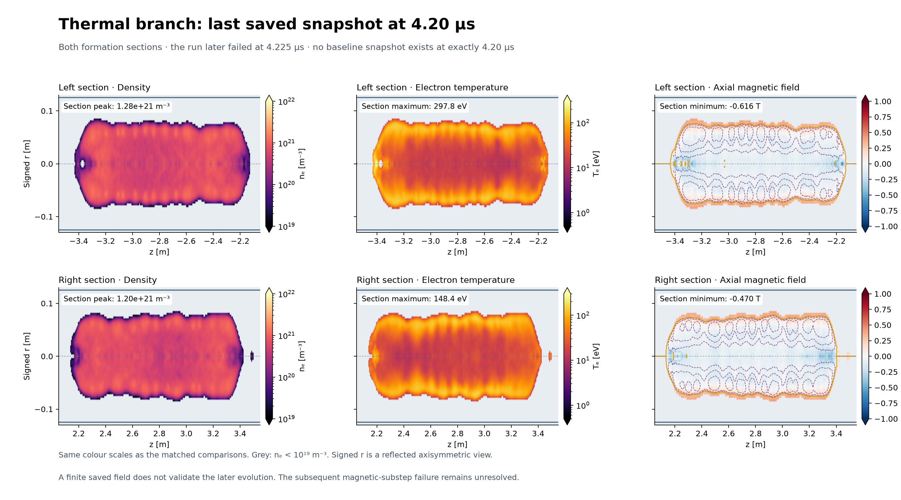
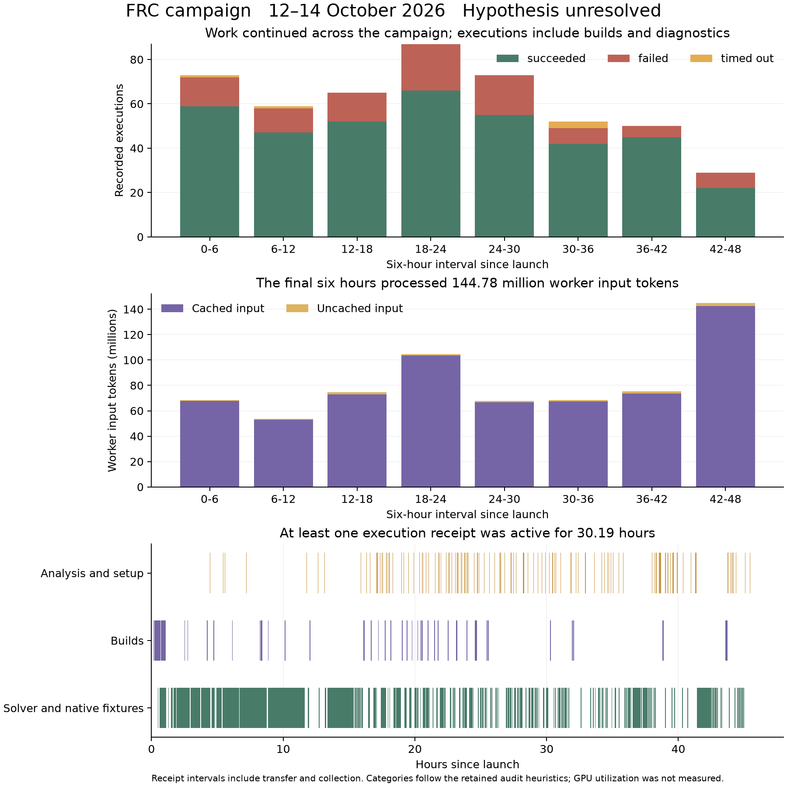

# 48 hour FRC campaign on eight GPUs

From 12 to 14 October 2026, Simjecture investigated whether electron heating
could preserve two forming plasmas long enough for them to merge. We gave the
agents a fixed scientific question, a remote machine with eight RTX 2080 Ti
GPUs and 48 hours. **The investigation did not answer the question.** Its thermal
trajectory reached 4.25 microseconds, before the required translation and collision.
The campaign ended at its original deadline with the hypothesis unresolved.

The agents built solver variants, tested energy accounting and timestep
sensitivity, and retained failed controls. A small fixture explained most of an
apparent energy discrepancy through boundary work. The same record exposed a
late controller loop that kept polling for assessment after experiments had stopped.

| Outcome | Recorded result |
|---|---|
| Execution | Deadline reached after 48 hours |
| Scientific hypothesis | Unresolved; zero accepted claim reviews |
| Final report | Independently assessed and accepted as a bounded unresolved account |
| Recorded executions | 488: 388 succeeded, 95 failed, 5 timed out |
| Evidence stage | All 488 remained exploratory |
| Recorded model usage | 773.25 million input tokens; 1.73 million output tokens |
| API equivalent for recorded usage | About **\$196–\$275**, under the pricing scenarios below |

## The physical question

A field-reversed configuration, or FRC, is a plasma configuration with reversed
axial magnetic field and closed magnetic flux. The task was to test whether
consistent electron-energy evolution, Joule heating and temperature-dependent
resistivity were sufficient to preserve plasma-bearing closed flux during inward
translation and produce a central merged FRC. The chamber geometry, coil drive
and nominal physical resistivity law were fixed.

The supplied axisymmetric hybrid-PIC model represented ions as particles and
electrons as a fluid. Its baseline used a density-based polytropic electron
closure. Testing the hypothesis required a thermal solver whose energy accounting
and numerical behavior were qualified, followed by a trajectory through contact
and relaxation. Early field reversal or a closed-flux candidate could not settle
the claim. This was a sufficiency test within the supplied simulation model;
it was not a reproduction of an experimental shot.

The human operator supplied the question, baseline, checkpoints, resource limits
and commissioning material. The worker chose its experiments and authored solver
changes and analyses. A director assessed strategy and affordability. Separate
review contexts examined instruments and the final report.

| Campaign setting | Configuration |
|---|---|
| Start and original deadline | 12 October 11:54:46 to 14 October 11:54:46, UTC+8 |
| Simjecture at launch | 0.6.2rc1, with operational repairs applied during the run |
| Workflow | Minimal mode, repair completion policy, director enabled |
| Worker | GPT-6.1 Sol, low reasoning effort |
| Director and reviewers | GPT-6.1 Sol, high reasoning effort, separate contexts |
| Available numerical hardware | Eight RTX 2080 Ti GPUs; the main thermal trajectory used six GPU ranks |
| Main thermal grid | 132 × 1472 cells in cylindrical r and z |
| Protected final reporting | Last ten minutes of the original budget |

The 48-hour campaign had a new identity after an earlier 24-hour campaign was
intentionally cancelled. Useful early work was inherited as context, without
inheriting scientific acceptance. Earlier preparation and manual trajectories
are outside the cost estimates here.

## What the simulations showed



This retained 4.20 µs snapshot shows the two upstream formation sections. Signed
radial coordinates reflect the axisymmetric fields for display. These are
exploratory saved fields; they do not establish a central merger. The figure
was prepared after the simulations from retained numerical outputs.

The polytropic baseline reached 20 µs. The new thermal trajectory reached
4.25 µs, with separated upstream closed-flux candidates. It did not establish
translation through contact, collision and relaxation, or a central merged
plasma-bearing FRC.

The full-geometry controls failed the declared one-percent field agreement
screen over 4.20–4.25 µs:

| Matched restarted timesteps | Magnetic field difference | Electron temperature difference |
|---|---:|---:|
| 2.5 versus 1.25 ns | 1.3781% | 0.9263% |
| 1.25 versus 0.625 ns | 1.2415% | 1.4725% |
| 25 versus 1.25 ns | 5.1419% | 2.6129% |

The faster 25 ns candidate was rejected. A repeat pair at 0.625 ns differed by
0.4796% globally in magnetic field, but by 2.8277% at the axis. One repeat pair
does not establish a noise distribution or supply a converged reference. Raising
the tested explicit resistivity cap or numerical density floor did not cure the
thermal replay failure. The planned Joule-off trajectory was not run after the
numerical gate failed.

The strongest retained diagnosis came from a much smaller calculation: a
stationary 32 × 32 fixture, without driven ports, lasting only 2 ns. Recording
the magnetic-update operands and the actual heating source separated incoming
boundary energy from the apparent mismatch between Joule heating and magnetic
energy loss.

| Local fixture quantity | 50 ps timestep | 25 ps timestep |
|---|---:|---:|
| Magnetic energy loss | 626.9294 µJ | 628.1913 µJ |
| Applied Joule source | 644.2197 µJ | 643.6096 µJ |
| Source minus magnetic loss | 17.2903 µJ | 15.4183 µJ |
| Incoming boundary contribution | 13.6860 µJ | 13.6164 µJ |
| Source minus theta-current dissipation | 3.62339 µJ | 1.81148 µJ |

Boundary energy explains most of the first discrepancy. The smaller difference
between the source and theta-current dissipation nearly halves with the timestep.
That is useful local accounting and timestep information. Some closure terms
share the same accepted operands, and the fixture excludes moving ions, driven
ports and the full pressure, floor and filtering terms. It does not qualify
global thermal conservation in the FRC.

## What consumed the two days



There were 45 build executions, with 31 successes and 14 failures. The remaining
work included source inspection, analyses, small fixtures and trajectories. The
488 receipts are not 488 independent plasma simulations. The retained audit
groups 215 receipts as solver or native fixtures, 228 as analysis and setup,
and 45 as builds, using entrypoint and capability heuristics.

The agent tried mesh, timestep, rank count, preconditioner and substep changes,
late checkpoints and half-domain feasibility. The director made 373 continue
decisions and 35 replans, and requested five experiment stops across three
decisions. Of 50 methods reviews, 49 concerned instruments and one concerned
production. Their 45 continue and five revise decisions did not qualify the
merger trajectory.

Sustained thermal stepping cost about 1,647 seconds per simulated microsecond
at 2.5 ns; the finer calculation cost about 2,940 seconds per microsecond.
Continuing from 4.25 to an illustrative 30 µs marker would require about
11.8 or 21.0 hours of stepping respectively, before controls and review, if
throughput stayed similar. Thirty microseconds was an advisory marker, not a
measured contact time. No affordable qualified route through the required event
was demonstrated.

### Simulation and model activity

| Measure | Recorded value | Meaning |
|---|---:|---|
| Time with at least one active execution receipt | 30.19 h, 62.9% of the budget | Includes transfer, collection and analysis |
| Summed source execution time for receipts requesting GPUs | 22.11 h | Job durations can overlap and include non-solver work |
| GPU allocations weighted by source duration | 62.75 GPU-hours | Requested GPUs × recorded source wall time |
| Eight-GPU capacity over 48 hours | 384 GPU-hours | Capacity reference; no continuous utilization trace was retained |
| Executions requesting GPUs | 167 | Includes fixtures and failed attempts |
| Worker requests with native counters | 2,726 | Several model requests can occur inside one CLI launch |
| GPU executions to worker requests | **1 to 16.3** | An activity ratio, not a measure of useful scientific output |

The requested GPU-hours amount to 16.3% of the capacity reference. This is an
allocation accounting measure, not measured GPU utilization. A reliable
simulation-time to generation-time ratio cannot be recovered: model sessions
included tool work and overlapped numerical jobs. The remaining receipt-free
time cannot all be assigned to inference or harness overhead.

## Model usage and API equivalent cost

The campaign used native Codex through OAuth. Its recorded token counters do not
give an invoice or a subscription-credit conversion. An API equivalent helps
readers compare the scale of the work with another deployment.

| Role | Input tokens | Cached input | Uncached input | Output tokens |
|---|---:|---:|---:|---:|
| Worker including final drafting | 657,471,990 | 647,476,480 | 9,995,510 | 986,477 |
| Director | 72,410,877 | 59,557,248 | 12,853,629 | 610,890 |
| Scientific and report reviewers | 43,217,061 | 36,578,048 | 6,639,013 | 125,597 |
| Memory synthesis | 146,966 | 86,016 | 60,950 | 7,253 |
| **Recorded total** | **773,246,894** | **743,697,792** | **29,549,102** | **1,730,217** |

Cached input is 96.18% of input and is already included in that column. The
435,084 reasoning tokens are already included in output. Resumed cumulative
counters were counted once per thread, across 1,311 launch records and 515
distinct threads. Eighty interrupted worker launches are covered by later
counters; 38 director threads and one memory thread have no usage counters.
Their consumption remains unknown.

The worker repeatedly processed a large retained context. Its median request
input was 237,151 tokens, its maximum 453,654, and it underwent 18 compactions.
The director and reviewers together account for 66.0% of recorded uncached input.
Oversight was a substantial part of the inference work.

For GPT-6.1 Sol Standard processing, the published rates checked on 14 October
2026 were \$2 per million uncached input tokens, \$0.10 for cached input, \$2.50
for cache writes and \$10 for output. Requests above 272,000 input tokens have
double input/cache rates and 1.5 times the output rate. Cache writes replace
the uncached-input charge rather than adding to it.
[Official OpenAI model pricing](https://developers.openai.com/api/docs/models/gpt-6.1-sol),
[API pricing](https://developers.openai.com/api/docs/pricing).

The retained worker request lengths allow that long-context adjustment for its
1,055 requests above the threshold. Reviewer and director counters are cumulative
per thread, so their individual request lengths cannot be recovered from this
export. Native counters also do not expose a separate cache-write count.

| Pricing scenario for recorded tokens | Other roles all short context | Other roles all long context |
|---|---:|---:|
| All uncached tokens charged at input rate | \$195.79 | \$248.24 |
| All uncached tokens charged at cache-write rate | \$212.35 | \$274.58 |

These give a **\$196–\$275 scenario range for recorded usage**, not a bound on the
actual bill. The 39 unmeasured threads are excluded. The scenarios use Standard
processing without regional premiums, hosted tool fees or tax. Charging every
request at short-context input/output rates would give \$150.77 and omit the
known long-context worker usage.

### GPU rental and the simulation to inference cost ratio

The actual node rental charge was not supplied. If the entire eight-GPU node
costs `r` dollars per hour and is rented for all 48 hours, its charge is `48 × r`.
The following are sensitivity examples, **not provider quotes**:

| Assumed whole-node rate | 48-hour rental | Rental plus API scenarios | Rental divided by API equivalent |
|---|---:|---:|---:|
| \$1 per hour | \$48 | \$244–\$323 | 0.17–0.25 |
| \$2 per hour | \$96 | \$292–\$371 | 0.35–0.49 |
| \$4 per hour | \$192 | \$388–\$467 | 0.70–0.98 |

The rental and recorded-token API equivalent become similar at about
\$4.08–\$5.72 per node-hour. Storage, electricity, earlier commissioning and
unreported model consumption are outside these totals. Human time is not priced.

## Failures that changed the next investigation

The late polling loop was a clear controller defect. After the last experiment
and report validation, 268 follow-up turns repeatedly waited for assessment.
Over roughly 2.35 hours before protected finalization, worker input increased
by **96.34 million tokens**. Narration cleared the previous action signature,
so an unchanged status command could appear new and reset the progress detector.
The controller kept requesting work without obtaining new evidence.

Large receipt inventories created a second failure. One failed audit carried
32,854 remote artifact entries, making its inventory alone about 5.36 MB. The
methods packet limit was 700 KB. Review admission failed because it included
the complete transport inventory alongside otherwise compact scientific material.

The worker also made a wrong diagnosis of the review API. It submitted
`inconclusive`, received a generic validation error, and concluded that the API
allowed only supported or falsified outcomes. The director repeated that claim.
The audit verified that `unresolved` was valid. Claim review still required
evidence-stage records, so fixing the word alone would not route a report based
on exploratory work. The final report assessor missed this API error while
accepting the bounded scientific account.

Subsequent harness work added parked waiting, earlier independent report
assessment and compact packets referencing hashed artifact indexes. Replaying
the retained late turns reduced progress-counter resets from 95 to two. The
large receipt projection fell from 5,362,008 to 4,928 bytes while retaining its
failed status. These are engineering replay results; the original 48-hour
campaign was not rerun, and long-campaign token savings have not been measured.
The [repair record](../testing/research-feedback-repair-20261014.md) includes
the live waiting checks and their remaining finalization limitation.

Numerical qualification remains separate work. Broken build wrappers, path and
type mistakes, and overinterpretation of solver logs belong to agent coding and
reasoning. Field disagreement, incomplete energy accounting and thermal failure
cannot be repaired by relabelling the results as evidence. Faster hardware would
reduce stepping cost, but would leave those problems and the polling loop intact.

The useful result is a narrower next objective: commission an affordable thermal
instrument before assigning another full merger investigation. A change of
physical model may be justified if the hybrid approach cannot pass its controls
within budget. That choice requires its own qualification. This run neither
validates a replacement solver nor rules out the heating hypothesis.

## Public data and reproduction

The public bundle contains numerical audit summaries, 488 execution rows and
2,726 worker usage rows. It omits personal paths, machine addresses, prompts,
native-session identities and raw checkpoint payloads. The accounting plots
and pricing scenarios can be reproduced from this bundle; full plasma-field
reproduction requires the original numerical outputs.

- {download}`Audit metrics <../../research/campaigns/frc-48h-20261014/metrics.json>`
- {download}`Execution table <../../research/campaigns/frc-48h-20261014/executions.csv>`
- {download}`Worker request counters <../../research/campaigns/frc-48h-20261014/worker-requests.csv>`
- {download}`Accounting figure as PDF <assets/frc-campaign-accounting-20261014.pdf>`

From the repository root:

```bash
uv run --with matplotlib python scripts/plot_frc_campaign_report.py
```

Add `--node-hourly-usd 2` to calculate the \$2 whole-node example, or use your
own hourly charge. The script checks token sums, execution counts, receipt
intervals and requested GPU-hours before calculating prices and drawing plots.
The original report and assessment hashes are retained in the public metrics;
this edited report corrects the API diagnosis and does not alter the campaign.
